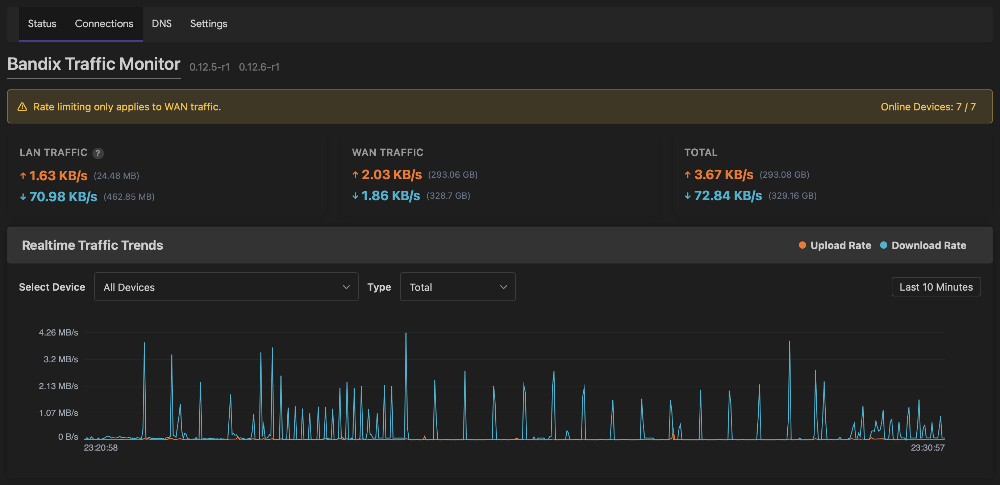
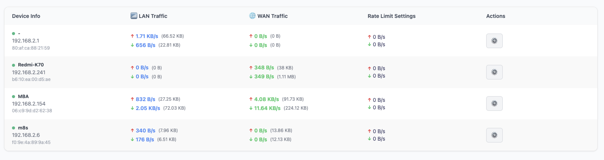
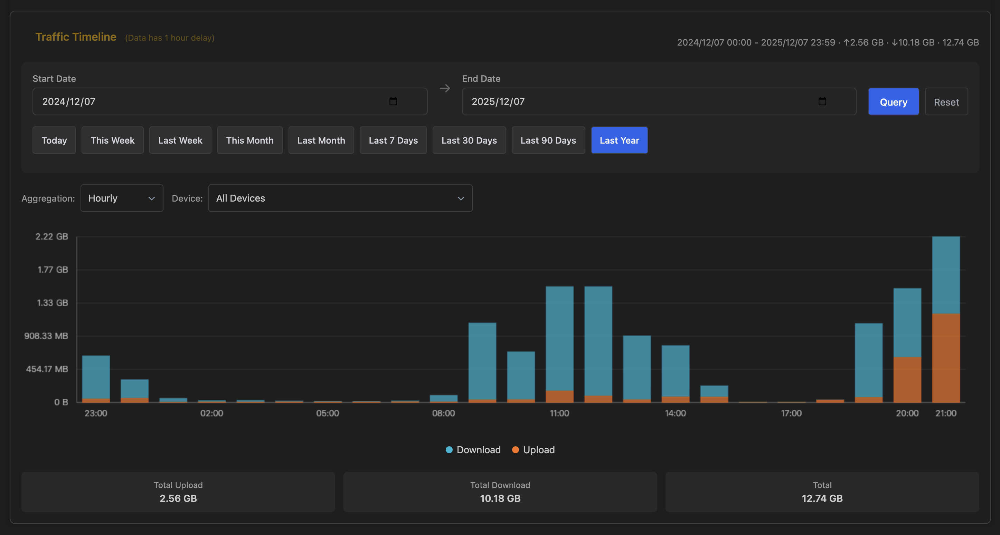
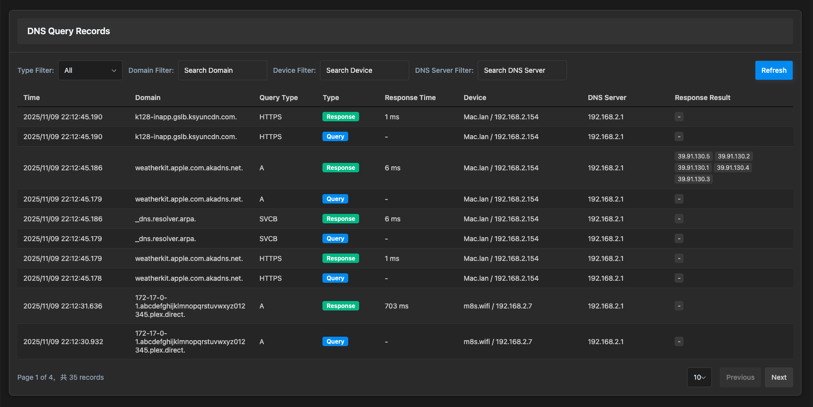

# LuCI Bandix

> Recommended for **single-interface** setups.
> Need **multi-interface** support? See [LuCI Bandix Plus](https://github.com/timsaya/luci-app-bandix-plus).

English | [简体中文](README.zh.md) | [架构文档](ARCHITECTURE.md)

[](LICENSE)


LuCI Bandix is a network traffic monitoring application for OpenWrt, providing intuitive traffic data visualization and analysis through the LuCI web interface.

## Introduction

LuCI Bandix is developed based on the LuCI framework, offering network traffic monitoring capabilities for OpenWrt routers. This application depends on the openwrt-bandix backend service and helps users view and analyze network traffic statistics in real-time.

**Note**: This application is primarily designed for home users and simple network environments. It is not recommended for complex network architectures (such as VLAN) or enterprise-level deployments.

**Important**: Please disable hardware flow offloading and Turbo ACC in OpenWrt before using this application.

## Installation


1. First install the openwrt-bandix backend

   Download the appropriate package for your device from [openwrt-bandix Releases](https://github.com/timsaya/openwrt-bandix/releases), then install:

   ```bash
   opkg install bandix_latest_architecture.ipk  # (or apk add --allow-untrusted bandix_latest_architecture.apk)
   ```

2. Install the luci-app-bandix frontend

   Download the package from [luci-app-bandix Releases](https://github.com/timsaya/luci-app-bandix/releases), then install:

   ```bash
   opkg install luci-app-bandix_latest_all.ipk  # (or apk add --allow-untrusted luci-app-bandix_latest_all.apk)
   ```

3. Configure your LAN interface in settings

   After installation, you can access the Bandix application through the LuCI web interface under the "Network" menu. Go to the Bandix settings page and select your LAN interface to enable proper monitoring. Make sure to check the "Enable" option to start the service.


## Screenshots










## Features

- Real-time network traffic monitoring
- Intuitive data visualization interface
- Seamless integration with OpenWrt system
- Automatically obtain the host name from DHCP/DNS (Static Leases)
- High-performance implementation based on Rust eBPF
- Support for LAN/WAN speed monitoring
- Support device TCP/UDP connection number monitoring
- Support for WAN speed limitation
- Per-device minute, hourly, daily, weekly, monthly, and lifetime WAN traffic quotas with automatic blocking
- Support IPv4/IPv6
- Persistent data storage
- Support real-time/daily/weekly/monthly monitoring
- Historical traffic trends and charts
- Support DNS query monitoring and statistical analysis


## System Requirements

- **Linux Kernel**: Linux 6.x and above
- **OpenWrt Version**: Recommended OpenWrt 24.10 and above


## Third-party Dependencies

luci-app-bandix requires the following dependency packages:

- **curl**: HTTP client library for network requests
- **luci-lib-jsonc**: JSON parsing library for data processing
- **jsonfilter**: JSON query tool for filtering and extracting data
- **jshn**: JSON shell library for shell script JSON operations

These dependencies will be automatically installed when installing luci-app-bandix, but some firmware may require manual installation of these dependency packages.


## Version Dependencies

The following table shows the version dependency relationship between luci-app-bandix and openwrt-bandix:

| luci-app-bandix version | Required openwrt-bandix version |
|------------------------|--------------------------------|
| 0.10.x                 | 0.10.x                         |
| 0.11.x                 | 0.11.x                         |
| 0.12.x                 | 0.12.x                         |


Please ensure you install matching versions to ensure compatibility and proper functionality.


## Team Members

- [timsaya](https://github.com/timsaya)
- [smallprogram](https://github.com/smallprogram)


## License

This project is licensed under the [Apache 2.0 License](LICENSE).

## Batch device deletion

Select devices individually or select all currently displayed devices, in either
the desktop table or mobile cards, then click **Delete selected** and confirm.
Polling preserves selections; filtering out a device deselects it. Successful
deletion refreshes the list silently. Partial failures and request errors show
results; failed selections are retained and network errors are not retried automatically.

Requires a Bandix service supporting `DELETE /api/traffic/devices/batch`. Deletion
removes device records, traffic history, hostname bindings, rate limit whitelist
entries, scheduled limits and quotas. Online devices may be rediscovered. LuCI
sends sequential batches of 50; the batch deletion RPC requires write permissions.

## Connection detail search

The connection details search filters the currently loaded page immediately in
the browser without making requests while typing. It matches protocol, state,
original/reply IPs and ports, flags, country, region, city, ASN and organization,
including tooltip details and hidden reply columns. Matching is case-insensitive;
space-separated terms must all match, e.g. `tcp 443 Berlin`. ASN queries accept
either `AS64512` or the number. Clearing the search restores the loaded rows.
The query persists across paging, refreshes and protocol/state changes. Server
pagination totals remain unchanged; a separate count shows matches on this page.
Search does not cover other pages that have not been loaded.

## IP location databases

Open **Settings → Connection Monitor Settings → IP location database**. Select
country-level or city-level location data, optionally check **ASN / network
organization**, then click **Download and enable**. Location and ASN databases
work together; city data already includes country information. A Bandix service
binary with GeoIP support is required.

Only the data source is shown as a permanent note. Download contents appear
when selecting a different combination, which only
replaces installed data after clicking **Download and enable**. Expand **Database
details** for installed databases, source, release version, build dates, storage
usage, directory and data terms. Upload
requirements appear in the upload dialog. Downloads use the [latest P3TERX / MaxMind GeoLite2 release](https://github.com/P3TERX/GeoLite.mmdb/releases/latest).
Use database build dates and release versions to assess freshness rather than
repository code commit dates.

The widget supports progress, cancellation, updates, enable/disable, deletion
and local `.mmdb` uploads. Failed updates retain installed data. Enable state,
profile and version persist on the router, and downloads continue after leaving
the settings page. Connection details show a compact location line with full
location, ASN and organization in the tooltip.

Directory changes use UCI's Save & Apply flow. Uploads are checked for extension
and size before transferring, using a memory-aware cap advertised by Bandix.
Management requires LuCI write permissions; file upload ACL is restricted to one
staging file.

Run `node --test tests/geoip.test.cjs` and validate translation catalogs with
`msgfmt` when modifying this feature.

## Listening address

Settings → Basic Settings → Listen Address configures `bandix.general.host`.
The default is `127.0.0.1`; IPv4 and IPv6 addresses are supported, including
`0.0.0.0` and `::` for all interfaces. Save & Apply restarts the service.
LuCI automatically follows the configured address and uses loopback for wildcard
listeners. The HTTP API has no authentication; restrict non-loopback access to trusted clients.
Changing the address requires a service binary supporting `--host`. Existing
configurations without this option keep the loopback default.

## Wi-Fi band display

Bands are identified from the primary channel frequency `w_freq` (MHz) returned by Bandix, supporting 2.4, 5 and 6 GHz.
Channel numbers overlap across bands, so `w_ch` alone is no longer used to infer the band.
Update both the server and LuCI. Older servers or unavailable frequencies show a neutral channel label instead of guessing the band.
Run `node --test tests/wifi.test.cjs` to verify this behavior.
